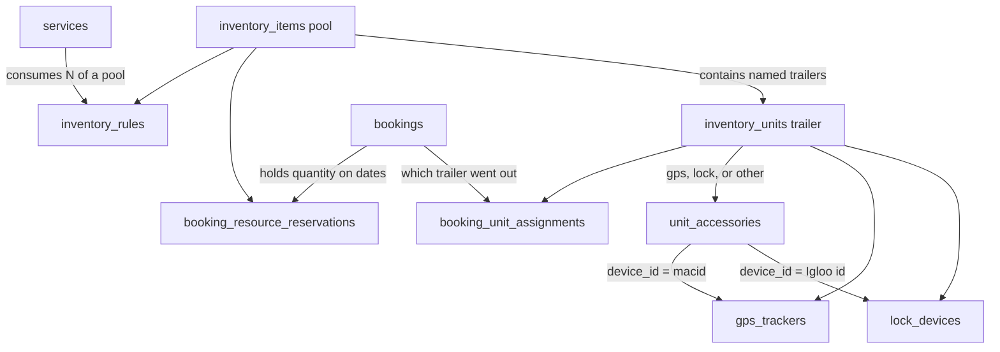

# U-Fill Dumpsters

Customer site for booking dumpster and equipment rentals. The app is a Vite + React frontend, with Supabase for data and edge functions, and Vercel deploying the `main` branch.

## Local development

```bash
npm install
npm run dev
```

The dev server runs at http://localhost:3000.

Copy `.env.example` to `.env.local` and fill in local values. Do not commit `.env` files.

## Design guide: capacity, trailers, and bookings

Two questions use two different links. They are not the same table.

| Question | Answered by | Points at |
|---|---|---|
| Can we accept this booking on these dates? | Capacity | `inventory_items` (the pool) |
| Which physical trailer, GPS, and lock went out? | Identity | `inventory_units` (one named trailer) |

`equipment` is a third thing: a customer add-on on the checkout form. It is not a trailer, a GPS, or a padlock.

### Why the tables exist

**`services`** is what the customer books (self-pickup, delivery, and so on).

**`inventory_items`** is a capacity pool, not one trailer. `total_quantity` is how many of that product you own. The calendar only needs "is a roll-off trailer free?", not "which VIN?".

**`inventory_rules`** connects a service to a pool. One row says: this service consumes N of this pool, and whether that hold lasts the whole rental day or only a delivery time slot. The pool does not know which products use it. The rule does. The same pool can be required by more than one service, with different occupancy.

**`booking_resource_reservations`** is the dated hold. When a booking is saved, the rules expand into rows: this pool, this date, this quantity. Availability sums those rows and compares them to `total_quantity`. A service with no rules is never capacity-checked.

**`inventory_units`** is one physical asset inside a pool, such as Sure Trac Trailer. You need this once two trailers share a pool, or once a GPS or lock has to hang on a specific trailer. Quantity on the pool cannot store a device id.

**`booking_unit_assignments`** is which unit left on which booking. It is written at pickup, not at payment. An open row has `released_at` null. One open booking has one open unit, and one open unit has one open booking. Past trips stay as released rows.

**`unit_accessories`** is the accessory superclass: hardware mounted on a unit. `kind` is `gps`, `lock`, or `other`. `device_id` is the vendor id (GPS macid or Igloo id). `notes` is a comment. It is not a secret. Login stays in environment variables and Supabase vault. A unit can have several GPS rows and several lock rows. One `device_id` can belong to only one accessory, so it cannot be linked to two units.

**`gps_trackers` and `lock_devices`** are the live subclasses. Each vendor row points at the unit and the accessory. GPS has yard fixes and fence events. A lock has padlock state and the yard bridge. They share the accessory table, but they are not the same device.

### Admin cards (Settings)

GPS and lock get their own cards because they are different subclasses, not because each physical device is a card.

- **GPS yard clock** lists every GPS. Linked rows are read-only: macid, last fix, and the serial unit, with Delete. If any GPS is still unassigned, one extra row on that same card picks the unlinked tracker and the unit, then Save writes the GPS accessory.
- **Lock accessories** lists every padlock the same way. Linked rows show Igloo id, presence, and the serial unit. If any lock is still unassigned, the extra row on that card mounts it on a unit.

Two GPS trackers are two rows on the GPS card, not two GPS cards. Two locks are two rows on the lock card. A GPS never appears on the lock card.

Capacity admin (serial units) can still add or edit accessory records. Settings is where a live vendor device is mounted on a unit.

### Schema



Capacity path: `bookings` → `booking_resource_reservations` → `inventory_items`, shaped by `inventory_rules` on `services`.

Identity path: `bookings` → `booking_unit_assignments` → `inventory_units` → `unit_accessories` → `gps_trackers` or `lock_devices`.

### How a booking uses both

1. **Booked.** The service's inventory rules reserve quantity on the pool for the rental dates. No trailer and no GPS are chosen yet.
2. **Pickup.** The GPS on a trailer leaves the yard during the pickup window. That tracker already knows its unit. If exactly one self-pickup booking matches, the system writes `booking_unit_assignments` for that unit and sets `rented_out_at`. If the tracker has no fresh fix, the padlock unlock does the same assignment from the lock's unit.
3. **Out.** `gps_tracker_state.open_booking_id` remembers the trip. The booking is tied to the trailer. The GPS and lock are whatever accessories are mounted on that trailer.
4. **Return.** From two hours before the scheduled end, a fresh GPS fix inside the yard sets `returned_at`, moves status to `pending_checklist`, sends the return email, and sets `released_at` on the assignment. An earlier yard visit does not finish the rental. If the tracker is silent, the padlock confirms the same return after the yard bridge hears it.

Example: pool Roll-off Trailer (`inventory_items`, quantity 1) contains Sure Trac Trailer (`inventory_units`). Settings links GPS `19176266213` and lock `SK3E124fc82a` onto that unit as two accessory rows, each on its own subclass card. A booking reserves 1 of the pool. Pickup assigns Sure Trac Trailer. Both devices follow that assignment because they hang off the unit, not off the booking row.
